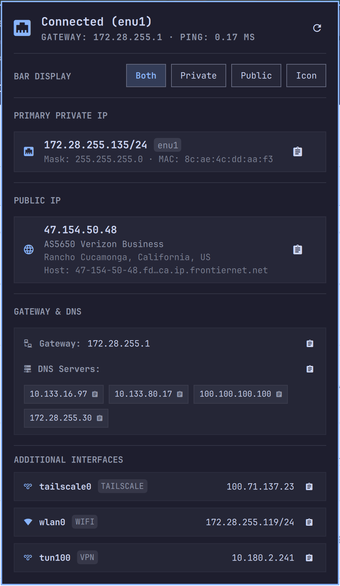

# IP Info for Omarchy

A polished, native Omarchy status bar panel and widget providing comprehensive network telemetry, public and local IP monitoring, gateway ping latency, DNS server inspection, and one-click clipboard copying.

<p align="center">
  <b>Dual Public & Private IP Bar Monitoring</b> • <b>4 Configurable Bar Modes</b> • <b>One-Click Clipboard Actions</b> • <b>Tailscale & VPN Support</b>
</p>

<p align="center">
  
</p>

---

## Features

- **Configurable Bar Display Modes**:
  - **`both`** *(default)*: Displays both primary private IP and public IP side-by-side (`󰈀 172.28.255.135 󰖟 47.154.50.48`).
  - **`private`** (or `primary`): Compact display showing only your local interface and LAN IP (`󰈀 172.28.255.135`).
  - **`public`**: Shows only your external public IP and globe icon (`󰖟 47.154.50.48`).
  - **`icon`**: Minimalist single icon indicator using standard Omarchy icon sizing (`󰈀` or `󰤨`).
- **Interactive In-Panel Mode Selector**:
  - Switch display modes instantly inside the popover card using the interactive `Both | Private | Public | Icon` button group.
  - Right-click the status bar widget to instantly cycle through modes without opening the popover.
- **Seamless State Persistence**:
  - Automatically persists the active mode to `~/.local/state/omarchy/settings/nertwork.ip-info.json` via `Quickshell.Io.FileView` without restarting or flickering the shell.
  - Supports initial default overrides via `displayMode` in `~/.config/omarchy/shell.json`.
- **Real-Time Kernel Netlink Monitoring**:
  - Uses `ip monitor address route` to detect address assignment, interface up/down events, and default routing changes instantly in microseconds.
  - Automatically re-probes public IP when your connection or gateway changes.
- **Comprehensive Network Telemetry**:
  - **Primary Interface**: IP address, CIDR prefix, subnet netmask, MAC hardware address, interface type (Ethernet, Wi-Fi), and active connection state.
  - **Public Network Details**: External IP, Autonomous System / ISP organization, city, region, country, and reverse DNS hostname.
  - **Gateway & Round-Trip Latency**: Default gateway IP with live sub-millisecond ICMP ping round-trip latency.
  - **DNS Resolvers with Individual Copying**: Inspect all active system DNS resolvers. Click any individual DNS pill to copy its address, or use the header button to copy all DNS resolvers at once.
  - **Additional Interfaces (Tailscale & VPNs)**: Point-to-point / `/32` tun devices, Tailscale nodes (`tailscale0`), secondary Wi-Fi, and VPN tunnels (`tun100`, `wg0`) are automatically detected, classified, and rendered with clean badges and copy actions.
- **Fast Bar Ergonomics**:
  - **Left-Click**: Toggle the detailed popover panel.
  - **Middle-Click**: Force refresh network data immediately.
  - **Right-Click**: Cycle through bar display modes (`both` → `private` → `public` → `icon`).
- **Quickshell IPC Integration**:
  - Exposes dedicated IPC targets for window manager bindings, custom scripts, and terminal automation.

---

## Installation and Removal

### Using Omarchy Plugin Manager

Install directly via the Omarchy plugin CLI:

```bash
omarchy plugin add git@github.com:nertwork/omarchy-ip-info.git --enable
```

Or via HTTPS:

```bash
omarchy plugin add https://github.com/nertwork/omarchy-ip-info.git --enable
```

### Manual Installation

Clone directly into your Omarchy plugins directory:

```bash
git clone git@github.com:nertwork/omarchy-ip-info.git ~/.config/omarchy/plugins/nertwork.ip-info
```

### Updating

```bash
omarchy plugin update nertwork.ip-info
```

### Removal

```bash
omarchy plugin remove nertwork.ip-info
```

---

## Configuration Reference

Add `nertwork.ip-info` to `bar.layout.left`, `bar.layout.center`, or `bar.layout.right` in `~/.config/omarchy/shell.json`:

```json
{
  "id": "nertwork.ip-info",
  "displayMode": "both"
}
```

### Configuration Options

| Option | Type | Default | Choices | Description |
|---|---|---|---|---|
| `displayMode` | `string` | `"both"` | `"both"`, `"private"`, `"public"`, `"icon"` | Controls how the widget renders in the Omarchy status bar. |

---

## IPC Interface Reference

IP Info exposes an IPC target under `nertwork.ip-info`. You can query status or trigger actions from terminal scripts or Hyprland keybindings.

### Available IPC Commands

```bash
# Query the current bar display mode
omarchy-shell nertwork.ip-info getMode

# Set display mode ("both", "private", "public", "icon")
omarchy-shell nertwork.ip-info setMode '{"mode":"private"}'

# Cycle to the next display mode
omarchy-shell nertwork.ip-info cycle

# Toggle popover panel open / closed
omarchy-shell nertwork.ip-info toggle

# Open popover panel
omarchy-shell nertwork.ip-info open

# Close popover panel
omarchy-shell nertwork.ip-info close

# Refresh network telemetry
omarchy-shell nertwork.ip-info refresh
```

### Hyprland Keybinding Example

Add a shortcut to `~/.config/hypr/hyprland.conf`:

```ini
# Toggle IP Info popover
bind = $mainMod, I, exec, omarchy-shell nertwork.ip-info toggle

# Cycle IP Info bar display mode
bind = $mainMod SHIFT, I, exec, omarchy-shell nertwork.ip-info cycle
```

---

## Controls & Shortcuts

| Input | Action |
|---|---|
| **Bar Left-Click** | Toggle the IP Info detailed popover panel |
| **Bar Right-Click** | Cycle bar display mode (`both` → `private` → `public` → `icon`) |
| **Bar Middle-Click** | Force refresh network and IP data |
| **Panel Bar Display Buttons** | Switch display mode interactively |
| **Panel Refresh Icon** | Refresh network details and re-probe gateway |
| **Click Any IP / Gateway** | Copy IP address to system clipboard |
| **Click DNS Pill** | Copy that specific DNS server to clipboard |
| **Click "Copy All DNS"** | Copy all active DNS servers as comma-separated list |
| **`Esc`** | Close panel |

---

## License

MIT License. See [LICENSE](LICENSE) for details.
